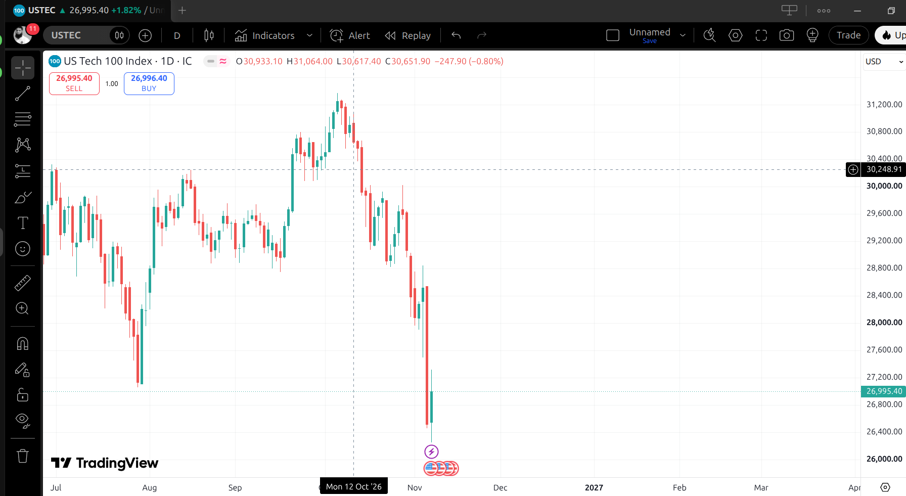
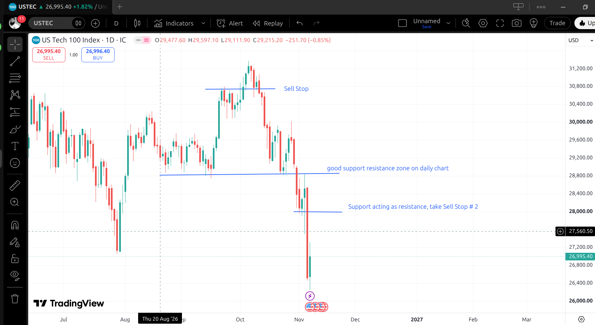
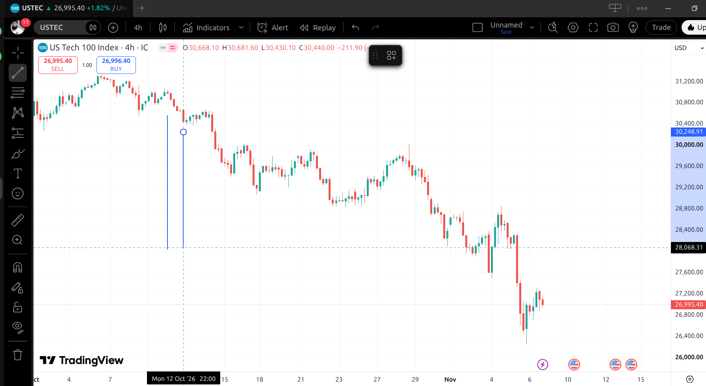
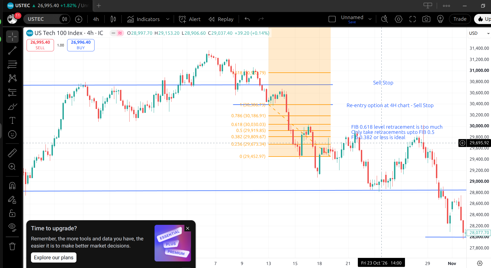
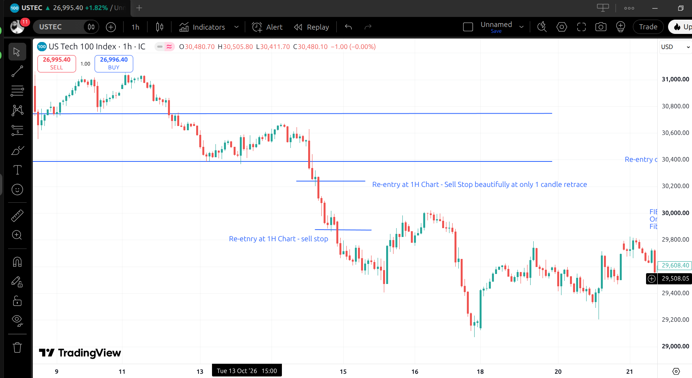
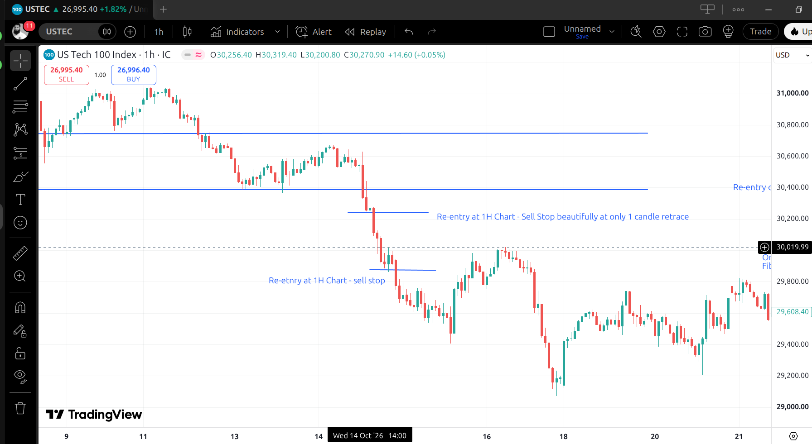
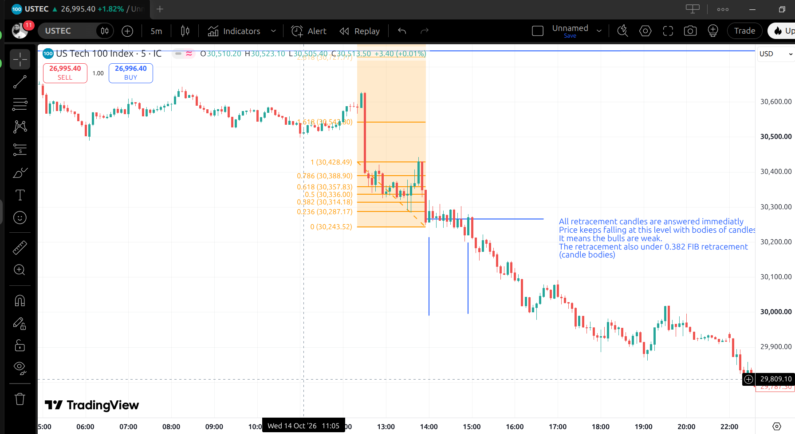

# USTEC, October 2026 — top-down entries and lower-timeframe confirmation

**The owner's markups of the Nasdaq 100 (USTEC, IC Markets) sell-off of October–November 2026, explained.** They are the basis of spec §4.7 (*daily first*, the entry ladder) and §4.8 (*lower-timeframe confirmation*). Charts from TradingView, marked up by the owner on 07-Nov-2026; prices are IC Markets USTEC.

**Terms**

- **Impulse leg** — a strong move in the trend's direction, mostly large candles that close near their extreme.
- **Correction (pause)** — the counter-trend part after an impulse: profit-taking, a few small candles or a short pull-back.
- **Retracement (Fibonacci)** — how much of the impulse the correction gives back, as a fraction of the impulse: 0.382 = 38.2 %. Measured here on candle **bodies** (open–close), not wicks.
- **Polarity flip** — a support level that, once broken, acts as resistance from below (and the reverse).
- **Top-down analysis** — reading the higher timeframes first for direction and key levels, then the lower ones for the entries.
- **Lower-timeframe decomposition** — looking at the candles of a smaller timeframe that make up one candle of a larger one (twelve 5-minute candles = one 1-hour candle).
- **Scaling in** — adding further positions, in the same direction, while the trend continues.

## 1. Daily — direction and key levels

| Plain | Marked up |
|---|---|
|  |  |

- After the early-October high (≈ 31,300) price failed to hold above a daily range. The **first entry is a Sell Stop below that daily level (≈ 30,750)** — the daily chart gives the direction (down) and the first entry.
- A **daily support zone at ≈ 28,850** held twice (late August, mid-October): a key level. When it broke in early November, it became resistance (**polarity flip**); the retest from below gave **Sell Stop #2 (≈ 28,000)**.

## 2. 4H — re-entry and the depth of the correction

| Plain | Marked up |
|---|---|
|  |  |

- After the daily breakdown, a **re-entry Sell Stop on the 4H chart at the previous swing low (≈ 30,386)** adds to the position.
- **Retracement grading** (owner): a correction that gives back **up to 38.2 %** of the impulse is ideal; **up to 50 %** is acceptable (half size, spec §4.7 D4); **61.8 % is too deep** — the counter-trend side is too strong, no entry.

## 3. 1H — scaling in

- Two further re-entries on the 1H chart (14 Oct): **≈ 30,240**, after a correction of a **single candle** ("Sell Stop beautifully at only 1 candle retrace"), and **≈ 29,860**. A one-candle correction is a valid pause (spec §4.7 D5).
- The lower timeframe offers entries the higher ones don't: in a strong trend the 4H and daily charts show few or no pauses, while the 1H chart still shows small ones. **A trend with almost no pauses on the higher timeframe, but pauses on the lower one, is a strong trend** (spec §4.8 L1).

## 4. 5-minute — inside one 1-hour pause candle

| 1H, 14 Oct 2026 14:00 — the pause candle | The same hour on 5-minute candles |
|---|---|
|  |  |

The 14:00 candle on the 1H chart is the pause before the 30,240 re-entry. Decomposed into 5-minute candles (12 per hour), it shows **how weak the counter-trend side was**:

- **Shallow correction.** The 5-minute impulse ran from ≈ 30,428 down to ≈ 30,244. The correcting candles' **bodies stayed inside the 38.2 % retracement** (≈ 30,314) — the wicks reached higher, the closes did not.
- **Fast rejection.** Each counter-trend (up) candle was **answered within one or two candles** by a down candle: buyers could not string two advances together.
- **Closes held near the low.** Price kept closing at the breakdown level with full bodies — the bulls were weak, the sellers absorbed every bounce.
- **Outcome:** the next hour broke below the pause, the Sell Stop filled, and the move continued to ≈ 29,800 the same day.

So the 5-minute structure confirms the 1H pause: **a pause whose lower-timeframe correction is shallow (≤ 38.2 % by bodies) and whose counter-trend candles are answered within one or two candles is a high-quality pause** (spec §4.8 L2).

## 5. The principles, in short

1. **Higher timeframes set the bias.** Monthly and daily charts give the direction and the key support/resistance levels.
2. **Entries come from a ladder of timeframes**: the daily chart down to the chart Scout is set on (on 15M: daily, 4H, 1H, 30M and 15M). The higher charts give the first entry, the lower ones scale the position up — with the daily direction only.
3. **Shallow corrections mean a strong trend**: ≤ 38.2 % ideal, ≤ 50 % at half size, deeper — no entry.
4. **Lower-timeframe pauses inside an unbroken higher-timeframe move** mark a strong trend and give more chances to join it.
5. **A higher-timeframe pause is confirmed on a lower timeframe** when its correction stays shallow and every counter-trend candle is answered within one or two candles.
